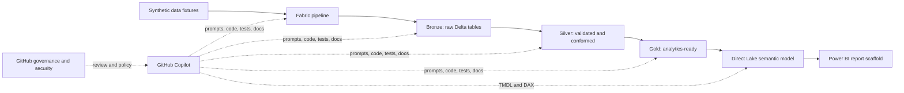
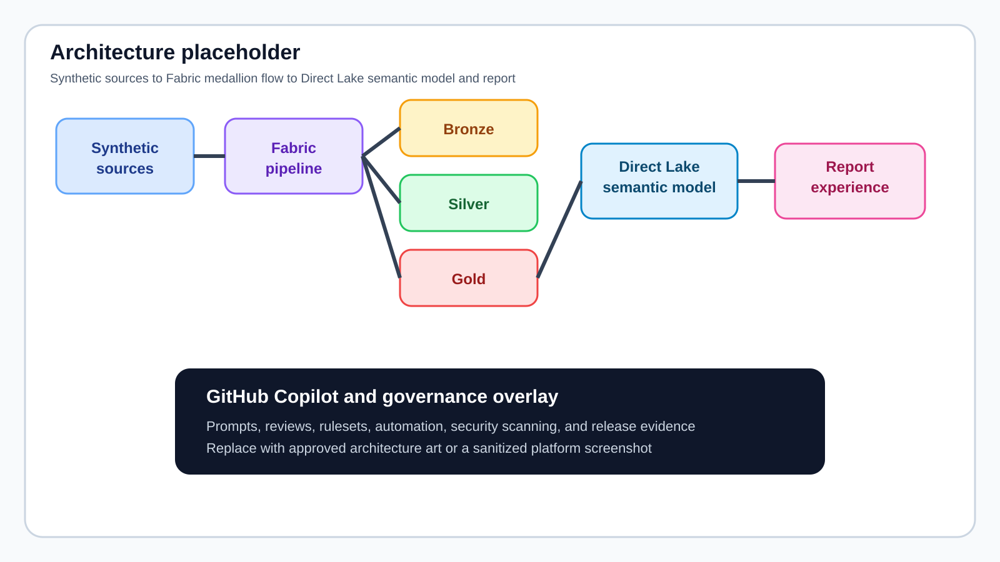
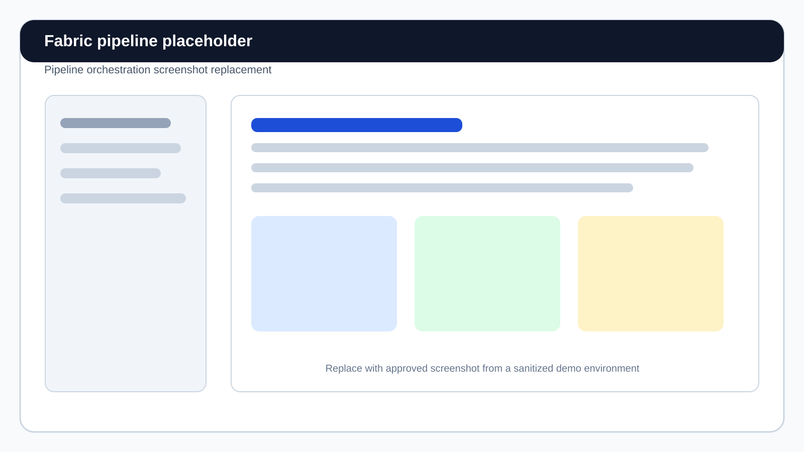
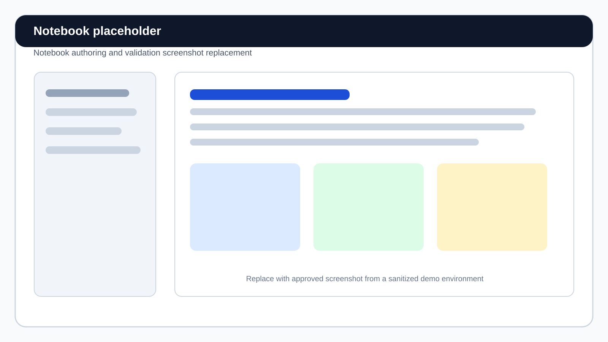
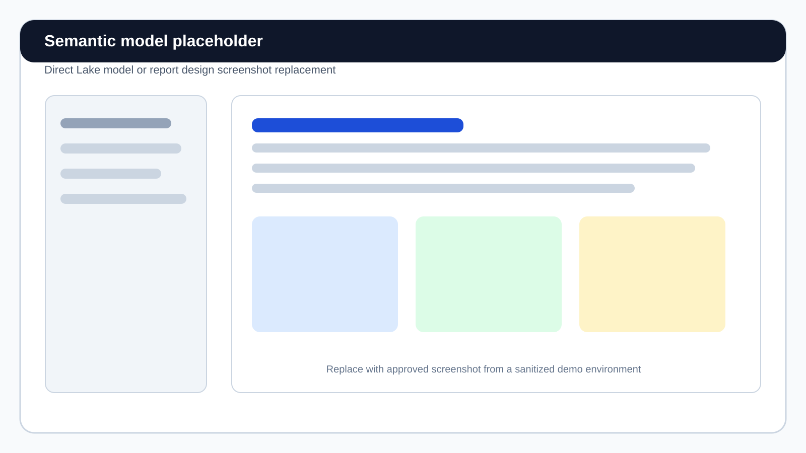

# Fabric Copilot Scenarios

`fabric-copilot-scenarios` is a customer-facing demo and learning repository that shows how GitHub Copilot helps Microsoft Fabric practitioners remove repetitive work across the analytics lifecycle.

The examples combine realistic prompts, deterministic synthetic data, one specifically approved aggregate public dataset, source-controlled Fabric artifacts, expected Copilot output, validation guidance, and extension exercises. The emphasis is not "what Fabric feature exists?" It is:

> **What work did Copilot eliminate, and what still requires practitioner judgment?**

## Who this repository is for

| Persona | Typical outcomes |
|---|---|
| Data Engineers | Generate and review pipelines, PySpark transformations, data-quality rules, and deployment automation |
| Data Analysts | Improve SQL, create analysis prompts, validate results, and generate reusable DAX |
| BI Developers | Review semantic models, author measures, improve descriptions, and prepare models for AI-assisted discovery |
| Data Scientists | Scaffold telemetry preparation, feature-ready transformations, and validation logic |
| Analytics Architects | Trace lineage, assess change impact, define production patterns, and review generated designs |
| Fabric Administrators | Demonstrate governance, environment promotion, GitHub controls, and security workflows |

## Reference architecture

The main storyline uses synthetic retail and customer-transaction data in a Fabric medallion flow. Healthcare, IoT, and financial examples provide focused domain exercises. Scenario 12 adds a separate, attributed public-data path for an archived Canadian Community Health Survey Power BI demonstration.



[View the detailed architecture](docs/architecture.md)



## Scenario catalog

| # | Scenario | Domain | Primary artifact | Work Copilot eliminates |
|---|---|---|---|---|
| 01 | [Data pipeline generation](scenarios/01-data-pipeline-generation/) | Retail purchases | Fabric Data Pipeline | Activity scaffolding, parameter wiring, retry policies, and documentation |
| 02 | [SQL optimization](scenarios/02-sql-optimization/) | Financial reporting | Fabric Warehouse T-SQL | Repeated-scan analysis, query rewrites, and optimization rationale |
| 03 | [PySpark notebook generation](scenarios/03-pyspark-notebook-generation/) | IoT telemetry | Fabric notebook | Schema, transformation, Delta, logging, and validation boilerplate |
| 04 | [Data-quality validation](scenarios/04-data-quality-validation/) | Synthetic healthcare claims | Notebook and quality pipeline | Rule implementation, quarantine handling, metrics, and tests |
| 05 | [Semantic model analysis](scenarios/05-semantic-model-analysis/) | Retail sales | PBIP and TMDL | Model inventory, best-practice review, and remediation planning |
| 06 | [DAX generation](scenarios/06-dax-generation/) | Retail and finance KPIs | DAX measures and queries | Measure scaffolding, time intelligence, formatting, and validation queries |
| 07 | [Documentation generation](scenarios/07-documentation-generation/) | Retail purchases | Data dictionary and runbook | Artifact reading, cross-reference extraction, and first-draft documentation |
| 08 | [Data-lineage investigation](scenarios/08-data-lineage-investigation/) | Retail medallion flow | Lineage manifest and impact report | Dependency tracing, graph construction, and downstream impact analysis |
| 09 | [Copilot Coding Agent](scenarios/09-copilot-coding-agent/) | Late-arriving retail data | Issue-to-PR exercise | Task decomposition, code, tests, documentation, and PR narration |
| 10 | [Fabric DevOps](scenarios/10-fabric-devops/) | Multi-environment deployment | Fabric REST CLI and Actions | ID discovery, deployment sequencing, validation, and release notes |
| 11 | [GitHub Advanced Security](scenarios/11-github-advanced-security/) | Safe security lab | CodeQL and supply-chain workflows | Vulnerability discovery, dependency triage, secret detection, and remediation guidance |
| 12 | [CCHS Power BI authoring](scenarios/12-cchs-power-bi-authoring/) | Historical public health aggregates | Import-mode PBIP/TMDL and three-page PBIR report | Data adapter, model, measures, visual wiring, validation, and facilitator documentation |

## Repository map

```text
scenarios/        Guided Copilot exercises and expected outcomes
datasets/         Deterministic synthetic fixtures plus approved, attributed public-data contracts
notebooks/        Fabric-compatible PySpark notebooks
pipelines/        Fabric Data Pipeline source definitions
semantic-models/  PBIP/TMDL Direct Lake and Import-mode reference models and reports
docs/             Architecture, governance, facilitation, and runbooks
prompts/          Portable prompt library by persona and scenario
infra/            Subscription-scoped Bicep for an on-demand Fabric F2 demo capacity
scripts/          Data generation, validation, and optional Fabric deployment
.github/          Copilot instructions, Coding Agent setup, governance, and security workflows
```

## Quick start

### 1. Prepare a local environment

```bash
python3 -m venv .venv
source .venv/bin/activate
python -m pip install --upgrade pip
python -m pip install -e ".[dev]"
```

On Windows PowerShell, activate the environment with:

```powershell
.venv\Scripts\Activate.ps1
```

### 2. Explore or regenerate demo data

```bash
python scripts/generate_data.py --help
```

The committed fixtures are intentionally small. Generation is deterministic so workshop output can be reviewed and tested.

The CCHS scenario uses a separately governed aggregate public-data snapshot. See [its source and refresh contract](datasets/public/cchs-annual/README.md); do not treat this as permission to add arbitrary public or customer datasets.

### 3. Validate the repository

```bash
python scripts/validate_repository.py
pytest
```

### 4. Choose a learning path

- Start with [persona paths](docs/persona-paths.md).
- Use the [getting started guide](docs/getting-started.md) for artifact prerequisites.
- Open a scenario, copy its prompt, inspect the expected output, and apply the review checklist.
- Use the [live demo prompt quick reference](#live-demo-prompt-quick-reference) for a presenter-ready sequence.
- Use the [facilitator guide](docs/facilitator-guide.md) for a customer session.

## Live demo prompt quick reference

These prompts are designed to run from the repository root in GitHub Copilot Chat, Copilot CLI, or a Copilot Coding Agent workflow. They reference committed files directly, so presenters do not need to paste large artifacts into the conversation.

Use prompts 1, 2, and 3 for a focused 15-minute demonstration. Prompts 4 through 7 are audience-specific pivots. Run prompt 3 on a disposable branch because it intentionally changes the starter files; the other prompts are read-only.

| Audience | Suggested prompts |
|---|---|
| Executive or mixed | 1, 5, and 6 |
| Fabric data engineer | 1, 2, and 3 |
| BI developer or analytics architect | 1, 4, and 5 |
| GitHub platform or security | 1, 3, 6, and 7 |

### 1. Open with the repository story

Use this prompt to establish the business outcome and the human-review boundary.

```text
Read README.md and docs/architecture.md.

Give me a customer-facing, 90-second explanation of this repository. Cover:
1. the synthetic data-to-report Fabric flow
2. three repetitive tasks GitHub Copilot can eliminate
3. three decisions that remain human-owned
4. how GitHub review, automation, and security keep the work governed

Use plain language, cite the repository paths that support each point, and do not invent tenant details, customer data, licensing, or enabled features.
```

### 2. Review the Fabric pipeline

This is a read-only engineering review that turns a large pipeline definition into a concise visual and prioritized findings.

```text
Read:
- scenarios/01-data-pipeline-generation/README.md
- scenarios/01-data-pipeline-generation/sample-prompt.md
- pipelines/retail-medallion.DataPipeline/pipeline-content.json

Review the committed pipeline against the scenario requirements. Return:
1. a Mermaid dependency graph
2. a requirement-to-activity mapping
3. prioritized strengths and gaps with file evidence
4. the smallest recommended edits
5. a human validation checklist for retries, failure propagation, parameters, and environment portability

Do not modify files. Do not recommend hardcoded workspace, lakehouse, item, tenant, or credential values. If a requirement is already satisfied, show the evidence instead of inventing a problem.
```

### 3. Implement the Coding Agent exercise

Run this prompt on a disposable branch. It provides a deterministic code-and-test demonstration without requiring a live Fabric tenant.

```text
Read:
- scenarios/09-copilot-coding-agent/issue/late-arriving-data.md
- scenarios/09-copilot-coding-agent/starter/retail_transactions.py
- scenarios/09-copilot-coding-agent/starter/test_retail_transactions.py

Implement every acceptance criterion from the issue. Modify only the two starter files, keep the implementation Python standard-library-only, preserve deterministic output ordering, and add focused unit tests for on-time, late, stale, future-dated, and replayed transactions.

Do not read or copy files under scenarios/09-copilot-coding-agent/expected/ until after your implementation and tests are complete. Run:

python3 -m unittest discover -s scenarios/09-copilot-coding-agent/starter -p 'test_*.py'

Then summarize the change as a pull request description that maps each acceptance criterion to code and test evidence. Leave merge approval as an explicit human decision.
```

Use this follow-up prompt to demonstrate review rather than generation:

```text
Review the current diff against scenarios/09-copilot-coding-agent/issue/late-arriving-data.md.

Do not modify files. Map every acceptance criterion to the implementing line and test, identify missing or weak coverage, call out risky edge cases, and finish with an approve-or-request-changes recommendation with reasons.
```

### 4. Assess the Direct Lake semantic model

Use this prompt for BI developers, data analysts, or Fabric model owners.

```text
Read:
- scenarios/05-semantic-model-analysis/README.md
- semantic-models/RetailSales/RetailSales.SemanticModel/definition/model.tmdl
- semantic-models/RetailSales/RetailSales.SemanticModel/definition/relationships.tmdl
- semantic-models/RetailSales/RetailSales.SemanticModel/definition/tables/

Assess the Direct Lake semantic model for star-schema quality, relationship direction, hidden technical keys, measure readability, format strings, descriptions, and time-intelligence assumptions.

Return the five highest-value findings in priority order. For each finding, cite the exact file evidence, explain the user or business impact, recommend a minimal correction, and state what a human model owner must validate. Do not modify files or invent model objects that are not present.
```

### 5. Trace a proposed lineage change

This prompt demonstrates cross-artifact reasoning from a notebook through the semantic model and report.

```text
Treat this as a proposed change only: the calculation of gross_margin_pct published to gold.Sales may change.

Read:
- scenarios/08-data-lineage-investigation/artifacts/lineage-manifest.json
- notebooks/retail-medallion/02_silver_transform.ipynb
- notebooks/retail-medallion/03_gold_aggregations.ipynb
- semantic-models/RetailSales/RetailSales.SemanticModel/definition/tables/Sales.tmdl
- semantic-models/RetailSales/RetailSales.Report/

Do not modify files. Trace the relevant upstream calculation and every documented downstream dependency. Return:
1. a Mermaid impact diagram
2. affected artifacts and owners
3. business metrics that could change
4. required validation in Silver, Gold, the semantic model, and the report
5. unknown or unverified lineage edges

Separate evidence from assumptions and cite repository paths throughout.
```

### 6. Explain deployment and governance

Use this prompt to connect Fabric delivery with GitHub environments, OIDC, approvals, and safe runtime overrides.

```text
Read:
- .github/workflows/fabric-deploy.yml
- scripts/fabric/config.example.json
- scripts/fabric/README.md
- scenarios/10-fabric-devops/artifacts/environment-matrix.json

Explain the dev-to-test-to-prod deployment flow as a reviewer-ready checklist. Show these two override chains separately:
- workflow inputs.environment -> CLI --environment -> config ENVIRONMENT
- environment variable FABRIC_WORKSPACE_NAME -> CLI --workspace-name -> workspace.displayName

Distinguish what the repository deploys from external prerequisites that must already exist. Include dry-run, approval, verification, and rollback checkpoints; identify where OIDC and least-privilege permissions are used.

Do not run deployment commands, modify files, assume features are enabled, or invent IDs, secrets, workspaces, capacities, or Fabric items.
```

### 7. Plan a safe GitHub Advanced Security demonstration

Use this prompt when the audience wants security controls without placing active vulnerabilities or secrets on the default branch.

```text
Read:
- scenarios/11-github-advanced-security/README.md
- docs/governance/github-advanced-security.md
- .github/workflows/codeql-analysis.yml
- .github/workflows/dependency-review.yml
- .github/dependabot.yml

Create a safe, presenter-ready GitHub Advanced Security demo plan covering CodeQL, dependency review, Dependabot, secret scanning, push protection, and Copilot-assisted remediation.

For each capability, distinguish:
1. what is represented by committed repository files
2. what requires GitHub settings, licensing, or organization policy
3. what the presenter can safely show on a disposable branch
4. what cleanup or human approval is required

Do not apply demo patches, introduce vulnerable code, create a credential, or claim that a feature is enabled. End with the work Copilot eliminates and the decisions the security owner retains.
```

For deeper exercises, use the complete [scenario prompt library](prompts/scenarios/README.md) and the audience-specific [persona guides](prompts/README.md).

### 8. Build the historical CCHS Power BI demo

Use this prompt for a BI developer, data analyst, or public-sector data practitioner.

```text
Read:
- scenarios/12-cchs-power-bi-authoring/README.md
- scenarios/12-cchs-power-bi-authoring/artifacts/model-authoring-prompt.md
- scenarios/12-cchs-power-bi-authoring/artifacts/report-design-brief.md
- datasets/public/cchs-annual/snapshot/manifest.json
- semantic-models/CCHSHealth/

Review or complete the historical CCHS Power BI demo. Preserve the approved eight-file public-data contract, the 2022 redesign warning, E/F/x handling, exact Statistics Canada attribution, portable data-root parameter, three-page PBIR design, HTML Content (lite) showcase, and native fallback.

Use Modeling MCP for model objects, refresh, and DAX validation; use report authoring for pages and visuals; use Desktop Bridge only for open, reload, status, and screenshots. Do not add customer data, official BC Government branding, tenant identifiers, secrets, or a third-party pbiviz binary.

Return validation evidence, Windows-only acceptance still required, the work Copilot eliminated, and the decisions that remain practitioner-owned.
```

## Event-ready paths

| Engagement | Recommended emphasis |
|---|---|
| Executive Briefing | Business problem, eliminated work, governance, and architecture |
| Fabric Workshop | Pipeline, PySpark, data quality, semantic model, DAX, and public-data Power BI scenarios |
| GitHub Dev Day | Copilot instructions, Coding Agent, pull-request flow, and GitHub Advanced Security |
| Customer Hackathon | Extension exercises, issue-driven delivery, and team review checkpoints |
| Data & AI Accelerator | End-to-end medallion flow, lineage, DevOps, and production-readiness review |

Detailed facilitation flows are in [`docs/demo-runbooks/`](docs/demo-runbooks/).

## Copilot guidance included in the repository

- [Repository-wide Copilot instructions](.github/copilot-instructions.md)
- Path-specific instructions for notebooks, pipelines, TMDL/DAX, Python, Markdown, and workflows
- [Portable prompt library](prompts/)
- Reusable IDE prompt files under `.github/prompts/`
- Coding Agent environment setup and issue templates

Copilot output is always treated as a draft. Each scenario includes explicit human review and validation steps.

## GitHub governance and security

The repository demonstrates:

- A CODEOWNERS template, contribution policy, issue forms, and pull-request templates
- Recommended rulesets and required-check guidance
- Least-privilege GitHub Actions with pinned dependencies
- CodeQL, dependency review, Dependabot, secret scanning, and push-protection guidance
- OIDC-based cloud authentication for the optional deployment example

Some controls are GitHub organization or repository settings and cannot be enabled by committed files alone. See [GitHub Enterprise governance](docs/governance/github-enterprise.md) and [GitHub Advanced Security](docs/governance/github-advanced-security.md).

## On-demand Fabric demo environment

Nothing is deployed by default. The repository includes subscription-scoped Bicep
for the smallest pay-as-you-go Fabric capacity (`F2`) and a persistent Fabric
workspace. The deploy command suspends the capacity after setup; use `up` only
while demonstrating the scenarios and `down` immediately afterward.

First-time setup:

```bash
az login
make configure
# Review scripts/fabric/capacity.local.json, especially subscriptionId and location.
make doctor
make deploy
```

Daily lifecycle:

```bash
make up       # resumes capacity and billing
make status
make down     # suspends capacity and ongoing capacity usage billing
```

`make fabric-connect` optionally connects the workspace to this GitHub repository.
It prompts for a GitHub PAT without echoing or persisting it. `make fabric-destroy`
requires the exact resource-group name and removes the workspace and dedicated
demo resource group. Suspending makes workspace content unavailable, and Fabric
can charge accumulated overage when a capacity is paused.

The separate item deployment helper resolves workspaces and items dynamically,
supports dry-run planning, retries transient failures, and handles Fabric
long-running operations. It still expects a schema-enabled `RetailLakehouse` and
synthetic files in the documented `Files/landing/...` paths; the capacity bootstrap
does not create the lakehouse or seed OneLake.

See [`scripts/fabric/README.md`](scripts/fabric/README.md) for configuration,
permissions, Git integration prerequisites, and item deployment commands.

## Screenshots

The repository ships with rendered placeholders so documentation remains complete before an approved demo environment is captured.

| Surface | Placeholder |
|---|---|
| GitHub Copilot prompt |  |
| Fabric pipeline |  |
| Fabric notebook |  |
| Semantic model |  |
| Security alerts |  |

## Data safety

Most included data is synthetic and fictional. Scenario 12 contains a separately documented, aggregated public Statistics Canada snapshot with provenance, licence, attribution, and historical-use limitations. No included dataset contains customer, confidential, respondent-level, PHI, PII, credential, or production tenant data.

See [data safety guidance](docs/governance/data-safety.md).

## Prerequisites and feature availability

Local content and validation require Python only. Live exercises may also require:

- A GitHub account with access to the relevant GitHub Copilot capabilities
- Organization enablement for Copilot Coding Agent
- GitHub security features appropriate to repository visibility and licensing
- A capacity-backed Microsoft Fabric workspace
- Azure CLI authentication and sufficient Fabric workspace permissions
- Power BI Desktop for local PBIP exploration
- For scenario 12 live authoring: a registered Power BI Modeling MCP server, the Power BI Report Authoring skill, Desktop Bridge, and the certified HTML Content (lite) visual when the optional custom card is demonstrated

Feature availability changes over time. Follow the linked official documentation in the governance guides before a customer session.

## Contributing and support

Read [CONTRIBUTING.md](CONTRIBUTING.md), [SECURITY.md](SECURITY.md), and [SUPPORT.md](SUPPORT.md) before proposing changes or reporting a problem.

## License

This project is licensed under the [MIT License](LICENSE).
