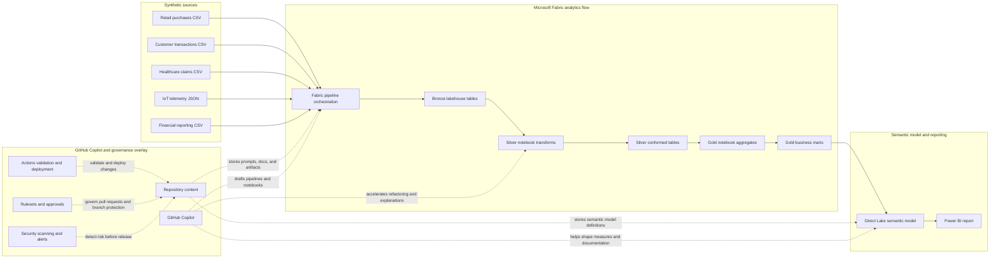

# Architecture

This repository is designed to show customers how GitHub Copilot helps Microsoft Fabric teams move from raw synthetic data to trusted business insight with less manual setup, less repetitive documentation, and fewer hand-built governance artifacts.

## Customer outcome

The shared storyline uses synthetic retail and customer transaction data to demonstrate how teams can:

- ingest safely curated sample data into Fabric
- shape it through bronze, silver, and gold layers
- publish a Direct Lake semantic model for reporting
- govern changes with GitHub review, policy, and security controls
- spend more time on business decisions and less time on scaffolding work

## End-to-end architecture

## Architecture image placeholder

Use the linked placeholder until approved screenshots or design assets are available.

## How to tell the story

| Layer | What the customer sees | What Copilot helps eliminate |
| --- | --- | --- |
| Synthetic sources | Safe demo data with realistic structures and known quality issues | Time spent inventing sample data, redacting sensitive records, and explaining unsafe shortcuts |
| Fabric pipeline | Parameterized orchestration, retries, checkpoints, and failure paths | Manual activity scaffolding, copy-paste wiring, and first-draft operational notes |
| Bronze and silver | Explicit schemas, lineage fields, and quality checks | Repetitive boilerplate for ingestion, conformance, and quarantine handling |
| Gold | Business-ready aggregates for analytics | Repetitive transformation patterns and summary-table design drafts |
| Direct Lake model | Star schema, measures, descriptions, and report-ready semantics | Tedious model inventory, DAX scaffolding, and documentation drafting |
| GitHub overlay | Review, policy, automation, and security signals | Manual governance checklists and fragmented release evidence |

## Design decisions

- The core path stays end to end: synthetic source to pipeline to lakehouse to semantic model to report.
- Transformations stay in notebooks, while orchestration stays in Fabric pipelines.
- Repository assets are portable. Workspace IDs, item IDs, secrets, and tenant-specific names are resolved outside source control.
- GitHub settings such as rulesets, secret scanning, and required checks are configured in GitHub itself, not solely by committed files.
- The on-demand environment helper can provision and suspend an `F2` capacity and create its Fabric workspace.
- The separate item deployment automation assumes a schema-enabled `RetailLakehouse` and uploaded synthetic files under `Files/landing/retail-purchases`, `Files/landing/iot-telemetry`, and `Files/landing/healthcare-claims`; it does not create the lakehouse or seed OneLake.

## Suggested customer talk track

1. Start with the business question, not the tool.
2. Show how the medallion path creates trust before visualization.
3. Point out where Copilot removes setup work but does not replace human review.
4. Close with governance: faster delivery only matters if changes stay safe and auditable.

## Related guidance

- [Getting started](getting-started.md)
- [Persona paths](persona-paths.md)
- [Artifact reference](artifact-reference.md)
- [Fabric deployment guidance](governance/fabric-deployment.md)
- [Prompt library](../prompts/README.md)
