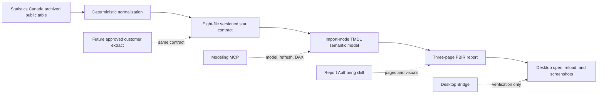

# BC CCHS Power BI demo runbook

## Purpose

Use this runbook to demonstrate how GitHub Copilot can accelerate a Power BI workflow for a BC Government data practitioner without using customer data. The demo starts with attributed public Canadian Community Health Survey aggregates, builds a source-controlled Import model, authors a three-page PBIR report, and preserves a contract for a later approved customer data-product extract.

## Audience and duration

- Best fit: data practitioners, BI developers, data analysts, analytics architects, and technical facilitators.
- Core demo: 20-25 minutes.
- Deep-dive workshop: 45-60 minutes.
- Customer context: British Columbia public-sector analytics, without official branding or implied endorsement.

## Customer outcome

At the end of the demo, the audience should be able to explain:

1. how provenance, licence, attribution, and limitations are encoded before modeling starts;
2. how Modeling MCP accelerates semantic-model creation and validation;
3. how report authoring accelerates PBIR visual construction;
4. why Desktop Bridge is a visual verification tool rather than a report authoring tool;
5. how estimate-quality symbols remain visible and testable; and
6. how a customer extract can replace the public snapshot through a stable contract.

## Source statement to read aloud

> This demonstration uses an adapted historical extract from Statistics Canada table 13-10-0096-01, covering 2015 through 2022. It contains aggregate published estimates only. The table is inactive, and the 2022 survey redesign creates a comparability break, so this is not current CCHS reporting and we will not make a simple year-over-year claim across 2022.

Required attribution:

> Adapted from Statistics Canada, Health characteristics, annual estimates, inactive, 2015 to 2022. This does not constitute an endorsement by Statistics Canada of this product.

## Demo architecture



## Tool boundary

| Tool | Demonstrate | Do not claim |
| --- | --- | --- |
| Power BI Modeling MCP server | Parameter setting, model objects, refresh, DAX query execution | That it authored page layouts or visuals |
| Power BI Report Authoring skill | PBIR pages, visual bindings, filters, formatting, and validation | That it refreshed the model or inspected Desktop rendering |
| Power BI Desktop Bridge | Open or reload, report status, screenshot capture | That it created visuals |
| GitHub Copilot in the repository | Data adapter, tests, prompts, TMDL/PBIR source, docs, and review assistance | That generated output is approved without practitioner review |

## Repository assets

- Scenario: [../../scenarios/12-cchs-power-bi-authoring/](../../scenarios/12-cchs-power-bi-authoring/)
- Public source contract: [../../datasets/public/cchs-annual/](../../datasets/public/cchs-annual/)
- Completed PBIP: [../../semantic-models/CCHSHealth/CCHSHealth.pbip](../../semantic-models/CCHSHealth/CCHSHealth.pbip)
- Modeling prompt: [../../scenarios/12-cchs-power-bi-authoring/artifacts/model-authoring-prompt.md](../../scenarios/12-cchs-power-bi-authoring/artifacts/model-authoring-prompt.md)
- Report brief: [../../scenarios/12-cchs-power-bi-authoring/artifacts/report-design-brief.md](../../scenarios/12-cchs-power-bi-authoring/artifacts/report-design-brief.md)
- DAX checks: [../../semantic-models/CCHSHealth/validation/model-validation.dax](../../semantic-models/CCHSHealth/validation/model-validation.dax)
- Live checklist: [../../scenarios/12-cchs-power-bi-authoring/artifacts/live-demo-checklist.md](../../scenarios/12-cchs-power-bi-authoring/artifacts/live-demo-checklist.md)

## Setup

### Repository setup

1. Clone the repository to a short local Windows path.
2. Create and activate a Python environment.
3. Install the development dependencies.
4. Run:

   ```powershell
   python -m pytest tests/test_cchs_data.py tests/test_cchs_model.py tests/test_cchs_report.py
   python scripts/validate_repository.py
   ```

5. Confirm the snapshot manifest reports 76,032 observations, 8 reference years, 11 geographies, 8 indicators, 6 characteristics, and 5 quality statuses.

### Windows and Power BI setup

- Current Power BI Desktop with PBIP/TMDL features required by the environment.
- Local Power BI Modeling MCP server registered and responsive.
- Power BI Report Authoring skill available.
- Desktop Bridge available.
- Certified HTML Content (lite) installed from AppSource if the custom card is in scope.
- No third-party `.pbiviz` copied into the repository.

### Safety check

- Use only the committed aggregate public snapshot.
- Do not add customer files, respondent records, PUMF data, PHI, PII, confidential material, tenant IDs, or credentials.
- Use neutral styling and sanitized screenshots.
- Confirm the audience understands that the future customer extract is out of scope.

## Core demo flow

### 1. Frame the business problem - 2 minutes

Show:

- [scenario README](../../scenarios/12-cchs-power-bi-authoring/README.md)
- [snapshot manifest](../../datasets/public/cchs-annual/snapshot/manifest.json)

Narration:

> The practitioner starts with decisions, not visuals: approved source, archive status, indicator scope, geography, quality-symbol behavior, and the report questions. Copilot then removes the repetitive implementation work around those decisions.

Checkpoint:

- The audience can state why this source is historical.
- The audience can state that the data is aggregate public data.
- The required attribution is visible.

### 2. Show the deterministic data adapter - 3 minutes

Show:

- [selection contract](../../datasets/public/cchs-annual/selection.json)
- [preparation script](../../scripts/prepare_cchs_data.py)
- [data schemas](../../datasets/schemas/)

Optional command:

```powershell
python scripts/prepare_cchs_data.py --help
```

Narration:

> Instead of manually reshaping a large archive in a one-off notebook, the source selection, label checks, quality handling, sorting, manifest, and contract schemas are source controlled. If the source drifts, the utility fails rather than silently dropping data.

Checkpoint:

- `E` values are retained with caution.
- `F` and `x` estimates are blank.
- No person-level fields exist.

### 3. Build or inspect the semantic model - 5 minutes

Open the completed PBIP or a disposable copy. Use the [Modeling MCP prompt](../../scenarios/12-cchs-power-bi-authoring/artifacts/model-authoring-prompt.md).

Live sequence:

1. Inspect available Modeling MCP operations.
2. Connect to the working PBIP.
3. Set `CCHS Data Root` to the local snapshot directory.
4. Inspect or create the eight tables and seven relationships.
5. Inspect the explicit measures and descriptions.
6. Refresh the Import model.
7. Execute each block in [model-validation.dax](../../semantic-models/CCHSHealth/validation/model-validation.dax) independently.

Default spot check:

| Metric | Expected |
| --- | ---: |
| British Columbia perceived health, 2022 | 51.3% |
| Canada excluding territories | 55.3% |
| BC minus Canada | -4.0 percentage points |

Narration:

> The key safety pattern is one published cell per fact row. The base measure returns a value only when the filter context resolves to one compatible cell, which prevents accidental aggregation across age groups, sexes, characteristics, or geographies.

Checkpoint:

- Relationships are one-to-many and single-direction.
- Technical keys and raw estimate are hidden.
- Percent values use a literal percent sign because the source stores percentage points.
- Ambiguous context returns blank.

### 4. Author or inspect the report - 5 minutes

Use the [report design brief](../../scenarios/12-cchs-power-bi-authoring/artifacts/report-design-brief.md) with the Report Authoring skill.

Show the three pages:

1. `BC Overview`
   - default slicers;
   - HTML Content (lite) spotlight;
   - native BC fallback card;
   - Canada, difference, rank, and status cards;
   - province comparison.
2. `Trend and Demographics`
   - BC versus Canada trend;
   - visible 2022 redesign warning;
   - age and sex comparisons;
   - detailed quality labels.
3. `Data Quality and Methodology`
   - caution and suppression counts;
   - status distribution and definitions;
   - source, licence, attribution, scope, and replacement contract.

Narration:

> The custom HTML card demonstrates controlled inline HTML, but it is not a dependency. The same selected BC percentage appears in a native card. The report still communicates the source, caveats, and quality state without the custom visual.

Checkpoint:

- The custom visual uses role `content`.
- No external HTML content or scripts are used.
- Every data visual has alt text.
- The attribution and redesign warning are visible.

### 5. Verify in Desktop - 3 minutes

Use Desktop Bridge to:

1. open or reload the PBIP;
2. confirm there is no unsaved-change conflict;
3. capture each page; and
4. compare the rendering with the committed design brief.

Narration:

> Bridge closes the edit-and-verify loop. It does not author the report; it gives the practitioner evidence that the source-controlled definition renders correctly in Desktop.

Checkpoint:

- No broken, clipped, overlapping, or empty visuals at the default state.
- Default slicers show Perceived Health, 2022, total age 12+, both sexes, and percent estimate.
- The native fallback remains visible.

### 6. Explain the customer-extract handoff - 2 minutes

Show the eight-file contract and `CCHS Data Root`.

Narration:

> The future customer extract does not get pasted into the prompt or committed to this repository. It is approved, classified, and transformed outside Git, then mapped to the same keys, grain, units, and quality statuses. The parameter points the model at that approved output, and the existing report can be regression tested.

Checkpoint:

- Privacy classification and source approval remain human-owned.
- Contract mapping is reconciled before refresh.
- Structural changes require explicit model and report review.

## Fallback flow

Use the fallback as soon as a live dependency is unavailable; do not spend customer time debugging the toolchain.

| Failure | Fallback |
| --- | --- |
| Modeling MCP unavailable | Open the committed TMDL, run automated tests, and explain the saved DAX validation queries |
| Report Authoring unavailable | Open the committed PBIR definition and the report design brief |
| Desktop Bridge unavailable | Open the PBIP directly in Desktop and use screenshots from the last approved acceptance pass |
| HTML Content (lite) unavailable | Continue with the native BC card and explain the optional dependency |
| Refresh path issue | Set `CCHS Data Root` to the clean-clone snapshot folder and retry; do not commit the absolute path |
| Live authoring runs long | Switch to the committed completed PBIP |

Always state which evidence is live and which evidence comes from the committed fallback.

## What Copilot eliminated versus what the practitioner still decides

| Copilot accelerates or drafts | Practitioner still decides and approves |
| --- | --- |
| Source archive normalization code | Whether the source is fit for the intended decision |
| Contract schemas and drift checks | Licence, attribution, privacy classification, and retention |
| Table, relationship, measure, and description scaffolding | Grain, business definitions, units, and comparison logic |
| PBIR visual definitions, bindings, formatting, and alt text | Information hierarchy, accessibility acceptance, and interpretation |
| DAX and structural validation assets | Trusted baselines and acceptable variances |
| Methodology and runbook first drafts | Survey redesign interpretation and customer-facing wording |
| Replacement-contract mapping draft | Approval of the customer extract and production release |

## Final Windows acceptance record

Do not describe the demo as fully accepted until all items below have evidence:

- [ ] Modeling MCP connected to the clean-clone PBIP.
- [ ] `CCHS Data Root` was set without committing an absolute path.
- [ ] All eight tables refreshed.
- [ ] All five DAX validation blocks passed.
- [ ] PBIR validation passed.
- [ ] Desktop Bridge opened or reloaded the project.
- [ ] Screenshots were captured for all three pages.
- [ ] Default-state values matched the deterministic spot check.
- [ ] The custom visual either rendered or the native fallback path was demonstrated.
- [ ] No customer or tenant identifiers appeared in files or screenshots.
- [ ] A second clean clone followed this runbook successfully.

## Close

End with:

> Copilot removed the repetitive work needed to turn reviewed decisions into data, model, report, tests, and documentation. It did not decide whether a historical survey is appropriate, whether two years are comparable, whether a customer extract is safe, or whether the final report is approved.
